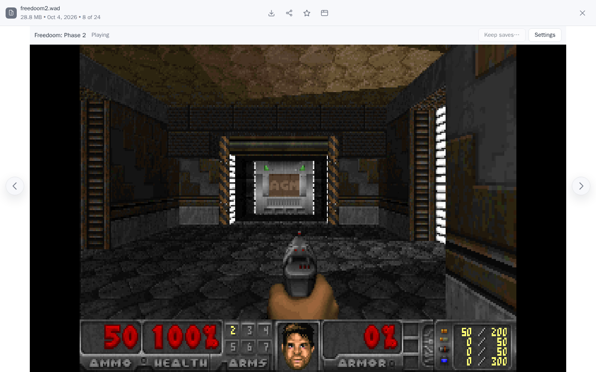
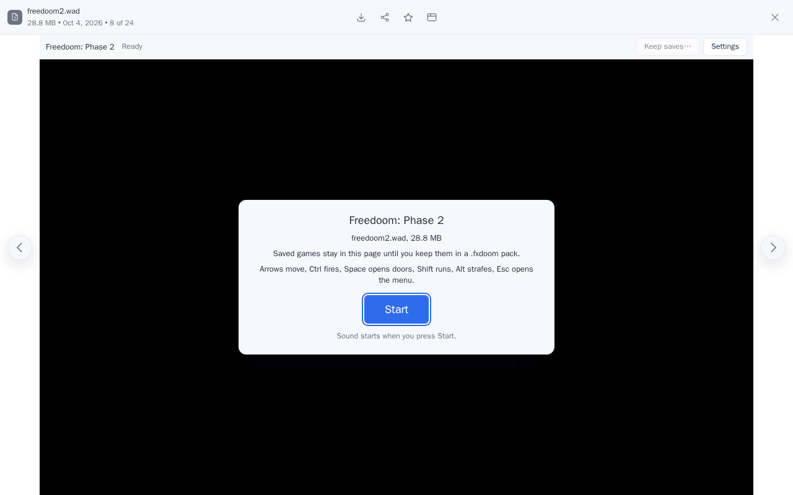
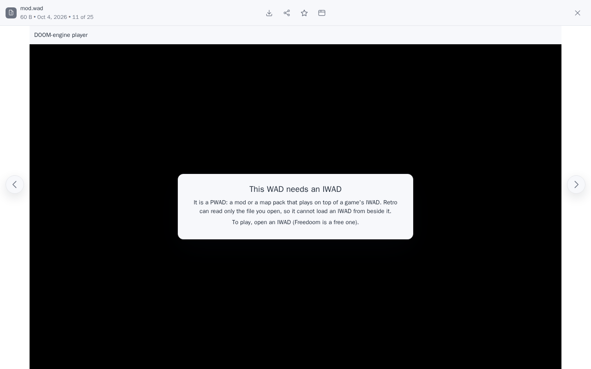
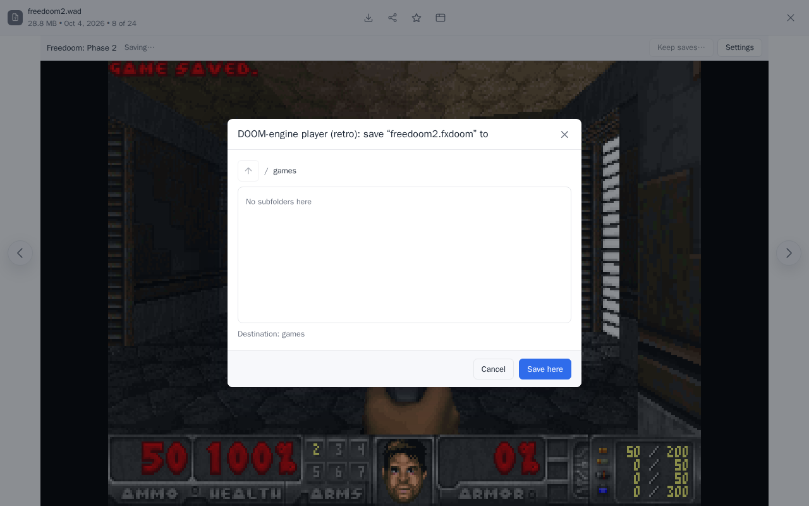
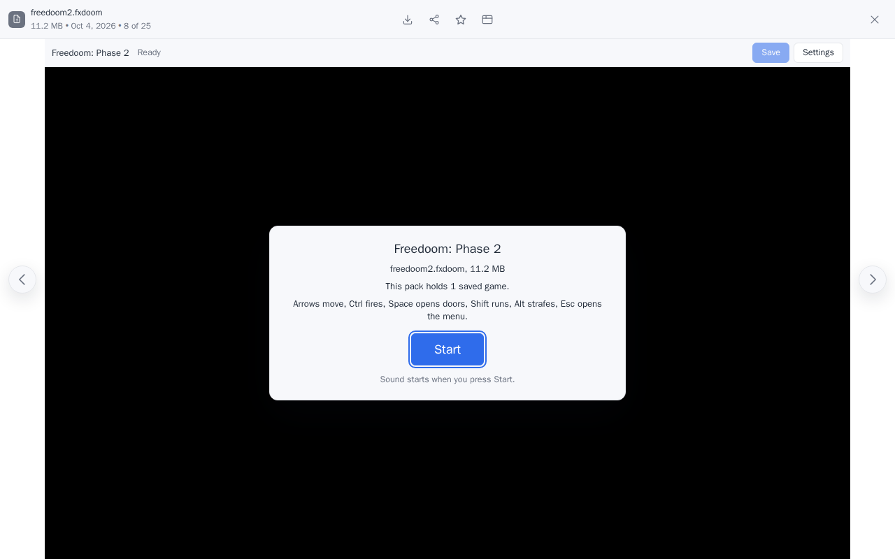
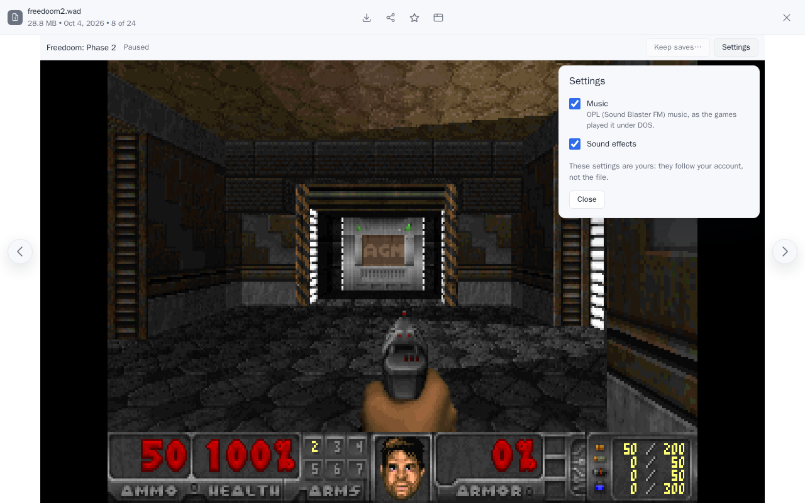
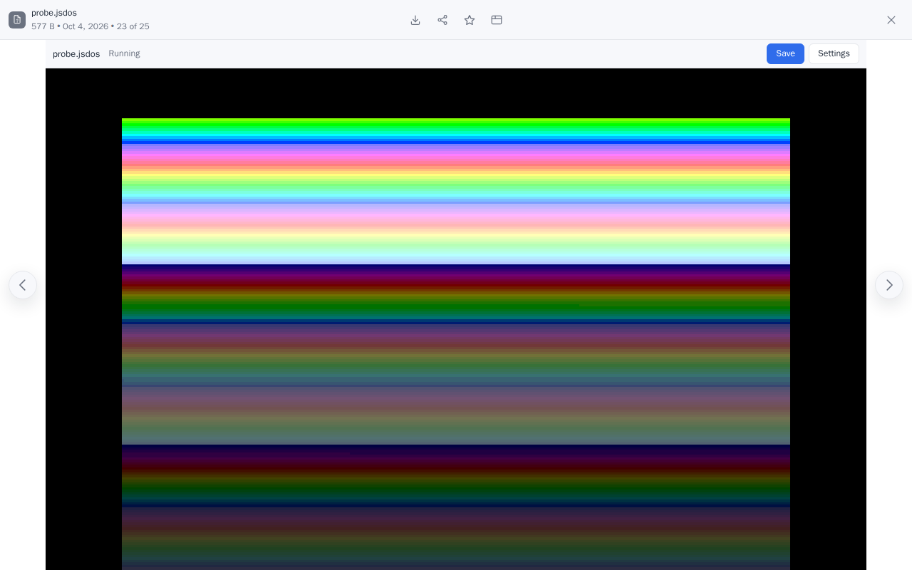
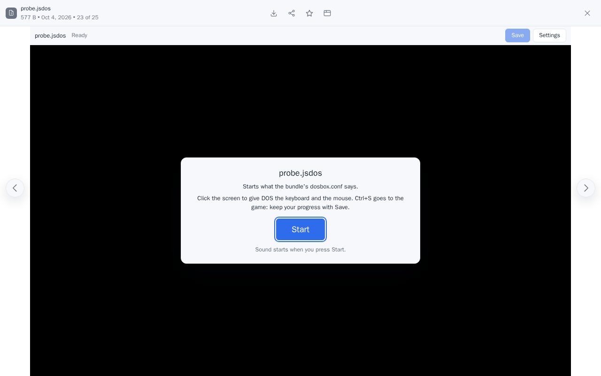
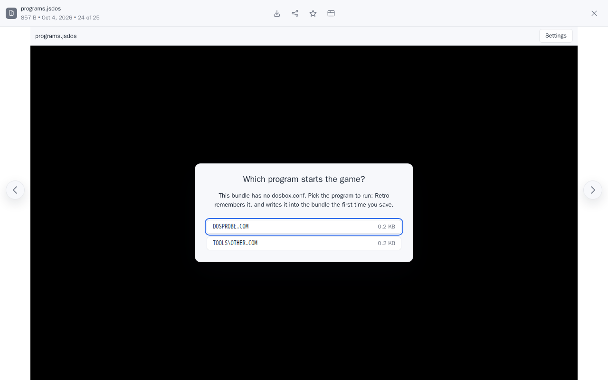
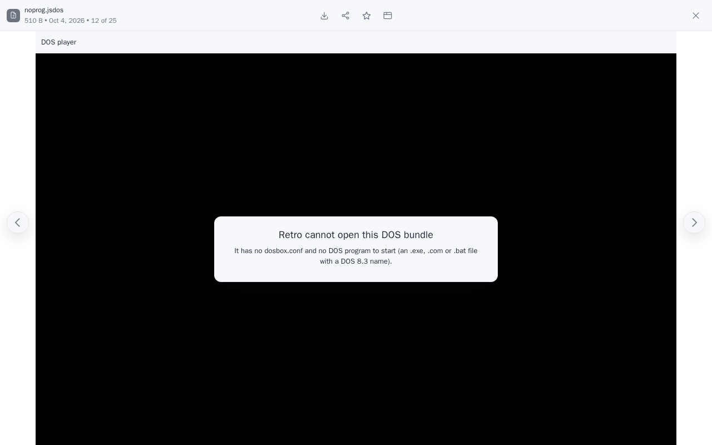

# filex-retro

**Retro** is a [filex](https://github.com/BRF-Tech/filex) app that plays old
games in place of the file preview. Double-click a game file in the explorer
and it runs, inside the sandbox filex draws for every app interface.



| Player | Opens | Engine |
|---|---|---|
| **DOOM-engine player** | `.wad` (an IWAD) and `.fxdoom` (this app's pack: a game with its saved games) | [doomgeneric](https://github.com/ozkl/doomgeneric) (Chocolate Doom's engine) compiled to WebAssembly, with Chocolate Doom's OPL music |
| **DOS player** | `.jsdos` (a [js-dos](https://js-dos.com) bundle, or a zip of a DOS game's folder) | js-dos 8.5.1's emulator (DOSBox compiled to WebAssembly), with Retro's own screen, sound and keys |

Retro needs **filex 0.51.0 or newer**: keeping saved games writes a new file
through filex's own save dialog, which apps can use from 0.51.0 on.

## Install

In filex's admin panel, open **Plugins** (System, Plugins & integrations),
the **Apps** tab, then **Install an app → GitHub repository**. Enter the
repository `BRF-Tech/filex-retro` and, for a particular version, its tag as
the ref (`v0.1.0`). filex reads [`filex-app.json`](filex-app.json), downloads
`ui.zip` from this repository's release and checks it against the sha256
the manifest pins; a package that does not match is refused. filex lists
what Retro asks for ([Permissions](#permissions)) before anything is
installed.

To install without GitHub, take `filex-app.json` and `ui.zip` from a
[release](https://github.com/BRF-Tech/filex-retro/releases) and use
**Upload files** in the same dialog.

## No game data

Retro ships **no game data**: no WAD (not even Freedoom), no DOS game. You
bring your own files and Retro opens them. If you have no WAD,
[Freedoom](https://freedoom.github.io) is a free one you can download
yourself; the screenshots here show Freedoom: Phase 2.

## The DOOM-engine player



Open an IWAD (DOOM, DOOM II, Final DOOM, Freedoom, FreeDM)
and press **Start**. The click on Start also starts the sound: browsers keep a
page silent until the person does something on it.

| Key | Does |
|---|---|
| Arrows | move and turn |
| Ctrl | fire |
| Space | open doors, press switches |
| Shift | run |
| Alt | strafe (with the arrows) |
| Esc | the game's menu |
| Tab | the map |
| F2 / F3 | save / load a game |
| 1-7 | weapons |

The game is recognised from what is inside the file, not from its name, so a
renamed IWAD plays too. Retro says what is wrong instead of starting when it
cannot play a file:

- a **PWAD** (a mod or a map pack) needs an IWAD under it, and an app in filex
  can read only the file you opened, not the IWAD beside it;
- Heretic, Hexen and Strife need other engines;
- a `.wad` that is not a DOOM-engine WAD (a Half-Life texture WAD, a Quake
  WAD, a Wii WAD) and a WAD whose directory is damaged are refused.



The game pauses while its page is hidden (another tab, the window
minimised) and while the settings are open, and goes on where it stopped.

### Saved games and the `.fxdoom` pack

An app interface in filex can read only the file it was opened with and write
that file back, or save a new file where you pick. It cannot write a save
beside a WAD. So saved games travel with the game:

1. Play a `.wad` and save in the game's menu (F2). Retro sees the new save
   and turns on **Keep saves…**.
2. **Keep saves…** writes a `.fxdoom` pack (the IWAD, your saved games and the
   engine's settings in one file) where you choose, through filex's own
   dialog. It opens in the WAD's folder; a name that is taken gets a free one
   beside it (`freedoom2-copy.fxdoom`).

   

3. Open the pack from then on. When the game writes a save, **Save** writes it
   into the pack: a new version of the file, so filex's version history keeps
   the earlier ones. filex's own Save does the same.



Ctrl+S is not a save shortcut here: in the game, Ctrl fires.

A pack is a zip:

| Entry | What |
|---|---|
| `fxdoom.json` | `{"format": 1, "iwad": "freedoom2.wad", "pwads": []}` |
| `wads/<iwad>` | the IWAD, under the name the engine knows it by |
| `config/default.cfg`, `config/doomgeneric.cfg` | the engine's settings (keys, volumes, screen size) |
| `saves/doomsav0.dsg` … `doomsav9.dsg` | the saved games |

It is laid out the same way every time (sorted entries, a fixed date). The WAD
is compressed once, by the browser that writes the pack first (browsers
compress the same bytes a little differently: Freedoom: Phase 2 came out 11.0
to 11.2 MB), and later saves copy it unchanged. Entries a newer Retro adds are
kept by an older one.

### Settings



**Settings** has two switches, both on at first: **Music** (the games' OPL
music, the Sound Blaster FM sound they had under DOS) and **Sound effects**.
They are yours: filex keeps them with your account, not in the file, and
they apply at once. With music off, the OPL chip is not emulated at all.

## The DOS player



Open a js-dos bundle (`.jsdos`) and press **Start**. A js-dos bundle is a zip
of a DOS game's folder with `.jsdos/dosbox.conf` in it, the DOSBox
configuration whose `[autoexec]` starts the game; the bundles made for
[js-dos](https://js-dos.com) are this kind. DOS runs in js-dos 8.5.1's
emulator (DOSBox compiled to WebAssembly), and Retro draws it itself: its own
screen, sound, keyboard and mouse, in filex's colours and your language. The
js-dos player's own interface, and its cloud features, are not part of it.



**A zip of a game folder works too**: rename it to `.jsdos`. With no
`dosbox.conf` in it, Retro lists the DOS programs it holds (`.exe`, `.com` and
`.bat` files with DOS 8.3 names), best guess first, and asks which one starts
the game; with only one it does not ask. Your choice is remembered for that
file (filex keeps it with your account), **Change program** on the Start
screen picks again, and the first time you save, the configuration that
starts it goes into the bundle.



Click the screen and the keyboard and the mouse go to DOS. Keys go by their
place on the keyboard, not the letter they type: a DOS program has its own
keyboard layout. Ctrl+S is a key for the game here. **Settings** has one
switch, **Sound**, kept with your account; the player pauses while its page
is hidden or the settings are open.

### Saving

What the game writes (its saved games, its settings) stays in the page until
you press **Save** (filex's own Save does the same). Retro then writes the
bundle again with the changes merged in, as a new version of the file, so
filex's version history keeps the earlier ones. The new bundle is written the
same way every time (entries sorted by name, a fixed date, the files that did
not change copied as they were), so saving the same changes twice gives the
same bytes. A bundle over 64 MiB is written whole by every save, and its
Start screen says so; filex uploads anything over 8 MiB in parts.

Retro refuses, and says why, a file that is not a zip, a damaged or
password-protected zip, zip64 or an unusual compression, an empty bundle, and
a bundle with neither a `dosbox.conf` nor a DOS program to start.



The DOS player runs the single-threaded DOSBox only (DOSBox-X needs a page
that is cross-origin isolated, which an app's frame is not), and without a
network: no IPX multiplayer.

## What the sandbox does not allow

These are filex's rules for every app interface, on purpose:

- no fullscreen (use the preview's own enlarge button), no pointer lock, no
  gamepad;
- no network: no multiplayer;
- no storage of the page's own: saves go into files, settings into your
  account.

## Permissions

At install filex shows what Retro asks for, eight lines: reading the files you
open with it (`files:read`) and writing saved games into them or into a new
pack (`files:write`), running its own interface (`ui`), compiling WebAssembly
in that interface (`ui:wasm-eval`), reading its own package
(`ui:package-fetch`), and being the viewer of `.wad`, `.fxdoom` and `.jsdos`
files.

## Building

The build is reproducible: pinned engine sources, a pinned Emscripten image,
a deterministic `ui.zip`.

```bash
npm ci                         # the filex app SDK (@brftech/filex-app-ui), js-dos's emulators and the test tools
scripts/build-engine.sh        # the DOOM engine, in emscripten/emsdk:6.0.10 (Docker)
scripts/build.sh               # ui.zip and ui.zip.sha256
scripts/build.sh --stamp       # ... and writes the sha256 into filex-app.json
scripts/build.sh --check       # ... and fails unless filex-app.json names it
```

`engines/doom/build.sh` clones
[ozkl/doomgeneric](https://github.com/ozkl/doomgeneric) at `dcb7a8d` and
[Chocolate Doom](https://github.com/chocolate-doom/chocolate-doom) at
`chocolate-doom-3.1.1` (only its OPL music and the Nuked OPL3 emulator),
applies `engines/doom/patches/`, and links them with Retro's platform layer
(`engines/doom/retro_platform.c`): a 320x200 frame drawn on a 2D canvas (no
WebGL), a main loop that runs a tic only when the 35 Hz game clock moves, a
clock that stops while the game is paused, sound through SDL_mixer. The wasm
memory is capped at 128 MiB. `ui.zip` refuses to grow past 64 MiB, and the
packer stops if game data turns up among its inputs.

A release is built the same way: pushing a tag `vX.Y.Z` runs
[`.github/workflows/release.yml`](.github/workflows/release.yml), which runs
the unit tests, checks that the tag, `filex-app.json` and `package.json`
name the same version, builds the engine and `ui.zip` from scratch, fails
unless the sha256 is the one `filex-app.json` pins, and attaches `ui.zip`,
`ui.zip.sha256` and `filex-app.json` to the GitHub release, with that
version's `CHANGELOG.md` section as its notes.

The DOS engine is not built here: it is js-dos 8.5.1's `emulators` package
from npm, pinned by `package-lock.json` and packed unchanged, only the
single-threaded DOSBox (`wdosbox`) and its zip library (`wlibzip`). Its
source is [caiiiycuk/emulators](https://github.com/caiiiycuk/emulators) at
`v8.5.1` ([NOTICE](NOTICE), item 6).

## Tests

```bash
npm test                       # unit tests (vitest): WAD reading, game recognition, the pack, keys, the shell,
                               # DOS bundles, the program picker, the merge, sound
```

`e2e/run.sh` runs the end-to-end tests on a Docker host
(`RETRO_E2E_ROOT` is its work folder, with a copy of this checkout in its
`src/`): a real filex (`ghcr.io/brf-tech/filex:v0.51.0` by default), Retro
installed through its admin API (the dry run's permission list checked),
Chromium, Firefox and WebKit through filex's own pages, Freedoom downloaded
for the test and checked against its release checksum. The DOS player is
tested with our own small DOS program, `e2e/dos/probe.asm` (assembled with
nasm for the test): it writes a file, Retro saves the bundle, and the
reopened bundle shows on screen that DOS finds the file.

## Licence

GPL-2.0-only (see [LICENSE](LICENSE)): the engines are GPL. Retro talks to filex
only through filex's app interface bridge, as a separate package; filex itself
stays MIT. [NOTICE](NOTICE) lists every component in the package, its licence
and the exact upstream commit; the licence texts are in [licenses/](licenses/).

"DOOM" is a trademark of id Software. Retro is not affiliated with or endorsed
by id Software; "DOOM-engine player" describes what the player is compatible
with.
